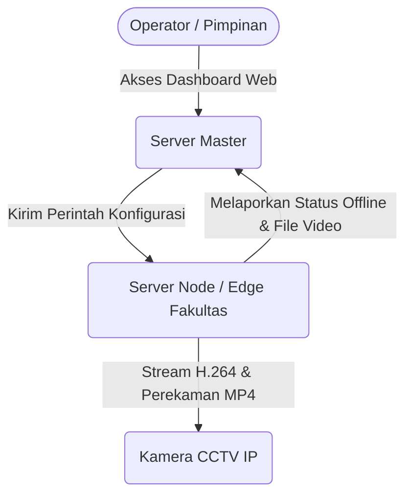

# 🏗️ Arsitektur Sistem (C4 Model): CCTV Monitoring Unpad

Sistem monitoring ini dirancang dengan arsitektur **Terdistribusi (Distributed/Edge Node Computing)** untuk memastikan tidak ada *bottleneck* (kemacetan I/O maupun CPU) pada Server Master. 

Metodologi dokumentasi ini menggunakan pendekatan **C4 Model** yang disederhanakan.

---

## 1. Context (C1 Level)

Tujuan utama sistem adalah mengizinkan Operator Pusat, Operator Fakultas, dan Pimpinan (Super Admin) untuk melihat CCTV seluruh kampus secara tersentralisasi, namun proses perekaman (*recording*), *streaming*, dan penyimpanan data video dilakukan secara desentralisasi di tingkat wilayah (Node Fakultas).



---

## 2. Container (C2 Level)

Bagaimana Server Master dan Server Node berinteraksi dalam ranah infrastruktur?

```mermaid
graph TD
    subgraph Server Master (10.69.69.21)
        UI[Laravel Web Dashboard]
        DB[(PostgreSQL 15)]
        Prom[Prometheus / Grafana]
    end

    subgraph Server Node Fakultas (10.69.69.41)
        Sync[Python: sync_node.py]
        Onvif[Python: onvif_agent.py]
        Go2RTC[Go2RTC Streaming Server]
        FFmpeg[FFmpeg Processor]
        Nginx[Nginx Static File Server]
        Storage[(Local Storage / NFS)]
    end

    %% Komunikasi Master ke Node
    UI -.->|CRUD Kamera / Ubah Retensi| DB
    UI -.->|Request Playback Video| Nginx
    
    %% Komunikasi Node ke Master
    Sync ==>|LISTEN cctv_update via pg_notify| DB
    Sync -->|POST update file & size_mb| DB
    Sync -.->|Reload WebRTC Streams| Go2RTC

    %% Proses Kamera
    FFmpeg -.->|Tarik RTSP| Kamera(CCTV Jaringan Lokal)
    Go2RTC -.->|Tarik RTSP| Kamera
    FFmpeg -->|Simpan Chunk MP4 15mnt| Storage
    Nginx -->|Sajikan File /storage/recordings| Storage
```

---

## 3. Komponen Inti & Cara Kerja (C3 Level)

### A. Pola Sinkronisasi Real-Time (Pub/Sub)
Sistem ini **TIDAK** menggunakan RabbitMQ, Redis, atau MQTT untuk komunikasi agen. Alih-alih, sistem ini memanfaatkan kemampuan bawaan **PostgreSQL `LISTEN` dan `NOTIFY`**:
1. Ketika Super Admin mengubah URL RSTP atau menghapus kamera via Laravel, Model Eloquent (Cctv.php) men-*trigger* `pg_notify('cctv_update', 'IP_NODE')`.
2. Python Threading di agen `sync_node.py` (yang terus menjalankan query `LISTEN cctv_update`) langsung menangkap *payload* tersebut dalam hitungan milidetik.
3. Agen Node akan memanggil `MASTER_URL/api/node-config` untuk mengambil konfigurasi CCTV terbaru.
4. Agen Node akan *menghentikan* (kill) *thread* FFmpeg kamera lama, dan memicu perekaman untuk kamera baru.

### B. Arsitektur Video Streaming & Perekaman
Kamera IP (`rtsp://...`) diakses oleh 2 komponen yang berjalan beriringan:
- **Go2RTC:** Berfungsi khusus men-*transcode* sinyal RTSP menjadi **WebRTC** untuk dilihat di browser Dasbor (Tingkat latensi sangat rendah < 0.5 detik).
- **FFmpeg (via `sync_node.py`):** Berfungsi menyalin paket video (`-c:v copy`) langsung ke format `.mp4`. Rekaman dipotong per 15 menit (`RECORD_DURATION=900`) dan didaftarkan ke Database Master agar tampil di menu *Playback*.

### C. Auto-Cleanup Data Perekaman
Sistem dirancang mandiri tanpa butuh *cronjob* eksternal. `sync_node.py` memiliki *background thread* yang secara periodik:
1. Membaca batas waktu penyimpanan / retensi (misal 14 hari) dari master.
2. Menghapus data *recordings* usang di *database*.
3. Menghapus direktori fisik (`rm -rf /var/www/html/storage/recordings/YYYY-MM-DD`) secara aman menggunakan perbandingan tanggal absolut (`datetime.strptime()`).
